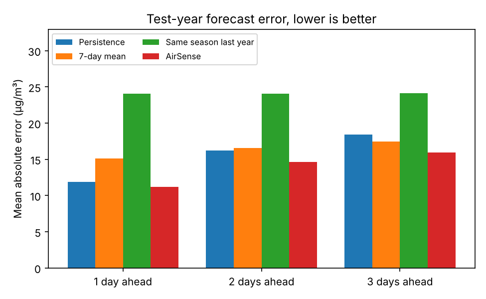
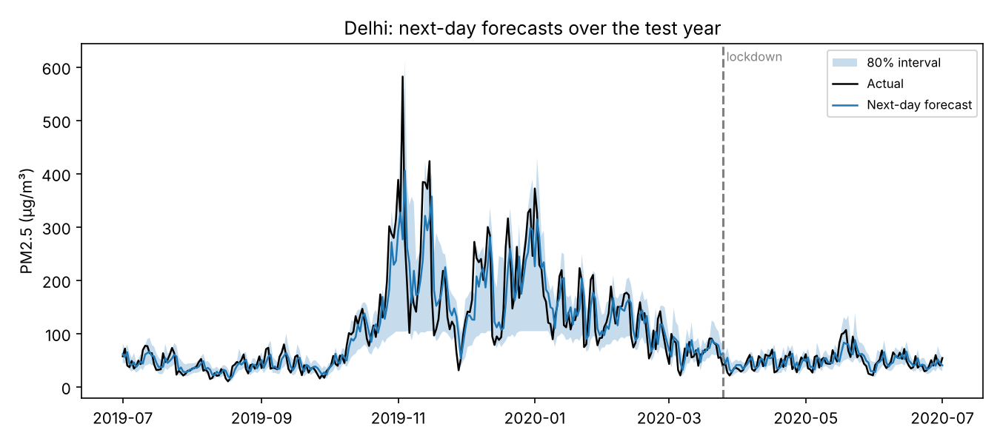
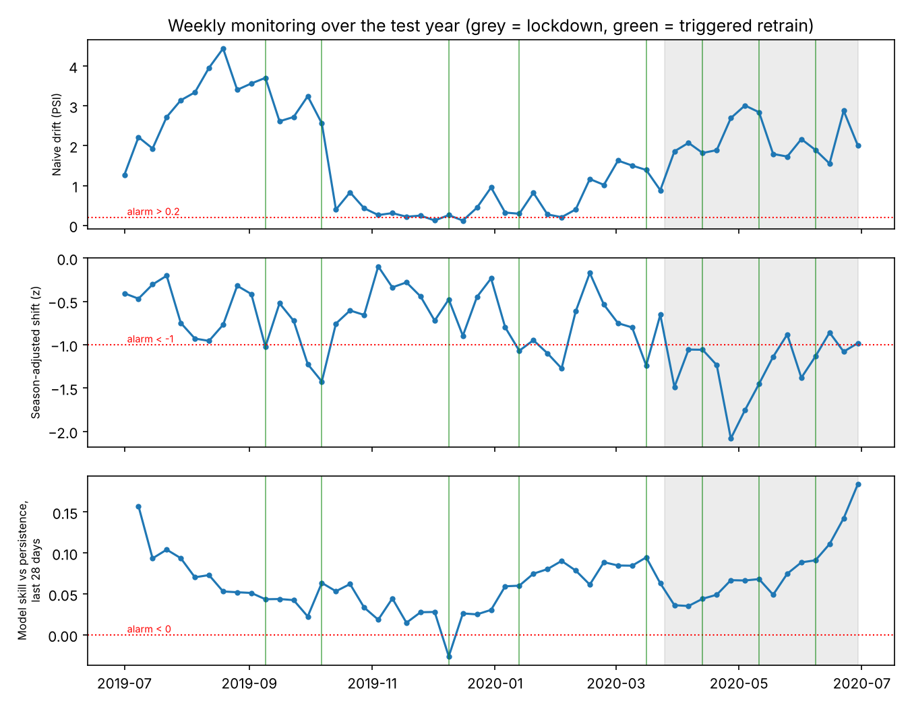
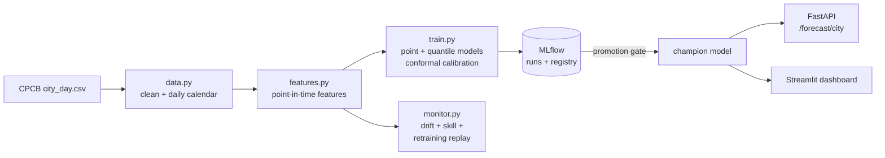

# AirSense

**3-day PM2.5 forecasts for 17 Indian cities, built and run like a production ML system: tracked experiments, a promotion gate, calibrated uncertainty, drift monitoring and a retraining policy tested against the COVID-19 lockdown.**

Each morning, AirSense forecasts fine-particle pollution (PM2.5) for the next three days, with an 80% range and the CPCB air-quality category. Forecasts are served by a FastAPI service and explored in a Streamlit dashboard. Every training run is logged in MLflow, and a new model only replaces the live one if it's at least as good on validation data. A monitoring replay shows how the system behaves through a monsoon, a winter smog season and the 2020 lockdown, and which retraining policy is worth its cost.

> **Data.** CPCB city-day measurements, 2015–2020, via [Kaggle](https://www.kaggle.com/datasets/rohanrao/air-quality-data-in-india). The model is evaluated on the final year (1 Jul 2019 – 1 Jul 2020), which it never saw during training. The raw data isn't stored in this repo; see [data/README.md](data/README.md).

---

## Results

### Forecast accuracy (test year, 17 cities, ~5,950 forecasts per horizon)

| | 1 day ahead | 2 days ahead | 3 days ahead |
|---|---|---|---|
| **AirSense** error (MAE, µg/m³) | **11.19** | **14.61** | **15.94** |
| Persistence ("same as today") | 11.88 | 16.21 | 18.39 |
| 7-day average | 15.11 | 16.54 | 17.45 |
| Same season last year | 24.06 | 24.08 | 24.12 |
| **Error removed vs persistence** | 6% | 10% | **13%** |
| Error removed vs *best* baseline | 6% | 10% | 9% |
| Correct air-quality category | 71% (persistence 69%) | 64% (62%) | 61% (59%) |
| "Poor or worse" alerts that were right | 82% (persistence 79%) | 80% (70%) | 80% (67%) |
| 80% interval: actual inside it | 78% | 78% | 76% |



**The honest headline: next-day air pollution is hard to beat.** Tomorrow's PM2.5 is mostly today's PM2.5, so "same as today" is a strong baseline. AirSense's advantage grows with the horizon, from 6% at 1 day to 13% at 3 days, because the model knows how pollution builds and decays and how the seasons move, while persistence just copies today. At 3 days, a public alert for a "Poor" day is right 80% of the time, versus 67% with persistence.

It doesn't win everywhere. In 3 of 17 cities (Hyderabad, Talcher, Amaravati) it is up to 2% *worse* than persistence at 1 day ahead. These cities' pollution changes little from day to day, so "same as today" is very hard to beat.

**Calibrated uncertainty.** The raw quantile models' "80%" ranges contained the actual value only 72–75% of the time. Conformal calibration on the validation set widened them just enough to reach 76–78%.



### Monitoring and retraining (replayed week by week over the test year)

| Signal | Weeks raising an alarm | ...of which before the lockdown |
|---|---|---|
| Naive drift check (PSI > 0.2 vs training data) | 51 of 53 | 37 |
| Season-adjusted shift (\|z\| > 1) | 18 of 53 | 7 |
| Model skill vs persistence < 0 (last 28 days) | 1 of 53 | 1 |

- **The textbook drift check is useless here.** It flagged 51 of 53 weeks because every monsoon and winter looks like "drift" compared with the full-year training data.
- **Comparing each week with the same city in the same month of past years removes the seasonal noise.** That check fired 5 days into the lockdown, and showed pollution averaging 1.26 standard deviations below normal for the season during it. Before the lockdown the average was 0.68, so pollution was already trending down compared with 2015–2018.
- **Drift is not degradation.** The model's skill stayed above zero in 52 of 53 weeks, including the lockdown. Its inputs are recent measurements, so it adapts to the new level automatically.

| Retraining policy | Year MAE | Lockdown MAE | Retrains |
|---|---|---|---|
| Never retrain | 11.20 | 7.29 | 0 |
| Every month | 11.15 | 7.19 | 11 |
| **When a signal fires** | **11.16** | **7.17** | **8** |

Retraining helps a little. Triggered retraining matches monthly retraining with **27% fewer retrains**.



---

## How it works



1. **Clean** (`data.py`): 17 cities with at least a year of history before validation. Every city is put on a complete daily calendar, so "yesterday" always means yesterday, even across sensor gaps.
2. **Features** (`features.py`): 26 features, all computed from data up to the forecast day: recent PM2.5 (lags, 3–30-day averages, variability), other pollutants, same season last year, and the season and weekday of the target date. The same function builds features for training and for the live API.
3. **Train** (`train.py`, `models.py`): one LightGBM model per horizon predicting log(PM2.5), plus 10th/90th-percentile models for the range, calibrated with conformalized quantile regression. Early stopping on validation; time-based split.
4. **Track and promote**: every run is logged to MLflow (parameters, metrics, charts, the model) and registered as a new version of `airsense-pm25`. It becomes `champion` only if its validation error is no worse.
5. **Serve** (`api.py`, `forecast.py`): `GET /forecast/{city}?as_of=YYYY-MM-DD` returns the 3-day outlook. The dashboard (`dashboard/app.py`) shows forecasts, accuracy and monitoring.
6. **Monitor** (`monitor.py`): replays the test year week by week, using only what was known each week, and compares retraining policies.

## Quickstart

```bash
git clone https://github.com/n1ck-04/AirSense-air-quality-forecasting-system-MLOps-.git
cd AirSense-air-quality-forecasting-system-MLOps-
python -m venv .venv && source .venv/bin/activate      # Windows: .venv\Scripts\activate
pip install -e ".[dashboard,dev]"
# put city_day.csv in data/raw/  (see data/README.md)
make all          # clean -> train -> monitor, about 2 minutes
make test         # 26 tests, uses fake data
make api          # http://127.0.0.1:8000/docs
make dashboard    # http://localhost:8501
make mlflow-ui    # http://127.0.0.1:5000: runs and the model registry
```

No Make on Windows? Each target is one line in the `Makefile`; run that command directly. No data yet? `make synthetic` writes a fake dataset so you can try the pipeline.

Example request:

```bash
curl "http://127.0.0.1:8000/forecast/Delhi?as_of=2019-11-01"
```
```json
{"city": "Delhi", "as_of": "2019-11-01", "observed_pm25": 388.4,
 "forecasts": [
   {"horizon": 1, "date": "2019-11-02", "pm25": 327.3, "lo": 103.6, "hi": 459.8, "category": "Severe"},
   {"horizon": 2, "date": "2019-11-03", "pm25": 268.9, "lo": 83.5, "hi": 408.0, "category": "Severe"},
   {"horizon": 3, "date": "2019-11-04", "pm25": 239.0, "lo": 86.8, "hi": 422.3, "category": "Very Poor"}]}
```

## Repository map

```
src/airsense/
  config.py      paths, time split, horizons, CPCB categories
  data.py        cleaning, daily calendar, PM2.5 category
  features.py    point-in-time features (training AND serving)
  baselines.py   persistence, 7-day mean, last year; skill score
  models.py      point + quantile models, conformal calibration, refit
  evaluate.py    MAE, skill, category accuracy, alert precision/recall, coverage
  train.py       training, MLflow tracking + registry, promotion gate, charts
  monitor.py     drift signals and retraining-policy replay
  forecast.py    3-day outlook for one city (used by API + dashboard)
  api.py         FastAPI service
  synthetic.py   fake data for tests and CI
dashboard/app.py Streamlit dashboard (runs from reports/ alone)
scripts/fetch_weather.py   optional weather download (Open-Meteo)
tests/           26 tests
reports/         metrics, forecasts, monitoring results, charts
docs/            design decisions, code walkthrough, exercises
```

CI (GitHub Actions) runs lint and tests, then the whole pipeline on fake data (clean, train with MLflow, monitor), builds the Docker image and requests a forecast from it.

## Limitations

- **No weather.** Wind, temperature inversions and rain drive PM2.5, and this dataset has none of them. `scripts/fetch_weather.py` adds weather from Open-Meteo, and training then includes it automatically; measuring the gain is the next experiment.
- **The data ends in July 2020.** The API forecasts "as of" a past date. A live deployment would read from the CPCB or OpenAQ feeds instead; nothing else changes.
- **PM2.5 category, not official AQI.** The official AQI is the worst of several pollutants' sub-indices.
- **City averages.** Each city is one series; pollution varies a lot between stations within a city.
- **One point per city for weather.** If added, weather is taken at the city centre.

## Documentation

- [docs/DECISIONS.md](docs/DECISIONS.md): every major design choice, the alternatives, and why
- [docs/WALKTHROUGH.md](docs/WALKTHROUGH.md): the code explained file by file, in reading order
- [docs/EXERCISES.md](docs/EXERCISES.md): extensions to build next
